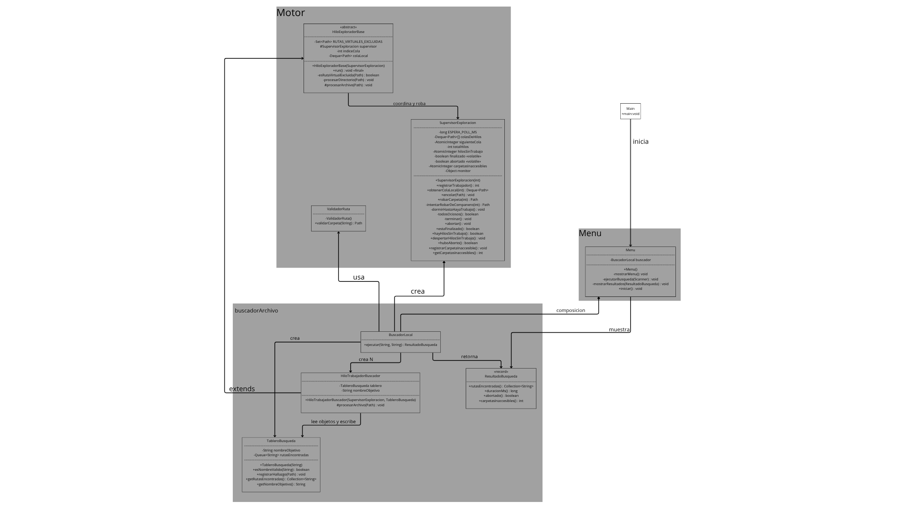

# 1. Arquitectura de Software y Patrones de Diseño

## Índice de Contenidos

1. [Patrones de Diseño y Filosofía Arquitectónica](#1-patrones-de-diseño-y-filosofía-arquitectónica)
2. [Clases, Responsabilidades y Modificadores (UML)](#2-clases-responsabilidades-y-modificadores-uml)

---

## 1. Patrones de Diseño y Filosofía Arquitectónica

Siguiendo el principio de diseño de Alexander Shvets (*Dive Into Design Patterns* / *Refactoring.Guru*), la arquitectura **separa lo que permanece igual de lo que varía**:

* **Lo que permanece igual**: El recorrido concurrente en *streaming* con NIO.2, la lectura de atributos, el filtrado de enlaces simbólicos y rutas virtuales del kernel, y el robo de trabajo entre hilos.
* **Lo que varía**: Qué hacer con cada archivo encontrado (buscar por nombre, detectar duplicados, clasificar por extensión, auditar tamaños, etc.).

---

### A. Template Method (`HiloExploradorBase`) — *Patrón de Comportamiento (OCP / LSP)*

* **Problema**: Replicar la lógica de navegación DFS, control de errores y coordinación entre hilos en cada nueva herramienta sería complicado y propenso a condiciones de carrera.
* **Solución**:
  * `HiloExploradorBase` implementa `Runnable` y congela el esqueleto de ejecución declarando `public final void run()`. El modificador `final` garantiza que ninguna subclase pueda alterar por error el recorrido, el robo de trabajo ni el protocolo de parada.
  * Toda la navegación de carpetas queda encapsulada en el método privado `procesarDirectorio(Path dir)`.
  * Siguiendo el **Principio de Hollywood** ("no nos llames, nosotros te llamaremos") y cumpliendo con **Abierto/Cerrado (OCP)** y **Sustitución de Liskov (LSP)**, el motor está cerrado a la modificación pero abierto a que cualquier subclase reemplace el criterio de negocio implementando un único método abstracto:
    ```java
    protected abstract void procesarArchivo(Path archivo);
    ```
    * `HiloTrabajadorBuscador` nunca controla el recorrido ni invoca `run()` o `procesarDirectorio()`, solo sobreescribe `procesarArchivo(Path)` y espera a que `HiloExploradorBase` lo llame cada vez que encuentra un archivo regular.
---

### B. Facade (Fachada) y Desacoplamiento con `ResultadoBusqueda`

* **El problema que quise evitar**: Permitir que `Menu` validara rutas, consultara núcleos (`availableProcessors()`), instanciara al supervisor y al tablero, y sincronizara el arreglo de `Thread` con `join()` habría acoplado la interfaz de usuario al motor concurrente.
* **Mi decisión (`BuscadorLocal` + `record ResultadoBusqueda`)**: Diseñé `BuscadorLocal` para encapsular toda la orquestación en un único método limpio que no imprime ni lee de consola (`System.out` / `System.err`):
  ```java
  ResultadoBusqueda resultado = buscador.ejecutar(nombreArchivo, rutaInicial);
  ```
* **¿Por qué retorno un `record`?**: `ResultadoBusqueda` empaqueta rutas, duración, estado de aborto y carpetas inaccesibles en una clase simple con campos `final` (sin escribir *getters*, `equals`, `hashCode` ni `toString` a mano; la inmutabilidad real de la colección se detalla en la [sección 1.D](#d-el-patrón-blackboard-tablón-compartido--arquitectura-de-sistemas-concurrentes)). Así `BuscadorLocal` no imprime nada y `Menu.java` (o cualquier futura GUI) se encarga de mostrar el resultado.

---

### C. Mediator (Mediador) — *Patrón de Comportamiento (SRP / DI)*

* **El problema que quise evitar**: Si los $N$ hilos trabajadores tuvieran que comunicarse directamente entre sí para coordinar el robo de tareas y ver quién está activo o dormido, se generaría caos de conexiones cruzadas. Esto también aumentaría el riesgo de condiciones de carrera y bloqueos mutuos.
* **Cómo lo implementé (`SupervisorExploracion`)**: Lo pensé como una mesa central con una bandeja para cada empleado: `SupervisorExploracion` (inyectado por constructor mediante **Inyección de Dependencias**) guarda las colas de todos los hilos (`colasDeHilos`) y lleva la cuenta de cuántos hilos están sin trabajo (`hilosSinTrabajo`). Cada trabajador solo toca su propia bandeja (`colaLocal`), y si se queda sin trabajo no habla con ningún compañero, le pide una carpeta al supervisor (`robarCarpeta`) y este se encarga de buscarla en otra cola.
* **El resultado**: Como `SupervisorExploracion` es un objeto compartido pasivo y no un hilo aparte, `robarCarpeta(indiceCola)` corre directamente sobre el mismo hilo que pidió trabajo sin incurrir en cambios de contexto adicionales. *(Ver la mecánica del robo en [02_Diseño_decisiones_de_concurrencia_y_trabajo.md](02_Diseño_decisiones_de_concurrencia_y_trabajo.md#1-cómo-diseñé-el-rol-del-supervisor-frente-a-los-hilos-trabajadores), y su espera pasiva en [03_decisiones_de_opti_SO_cache_Concurrencia.md](03_decisiones_de_opti_SO_cache_Concurrencia.md#c-espera-pasiva-y-sincronización-con-monitor-en-supervisorexploracion))*.

---

### D. El Patrón Blackboard (Tablón Compartido) — *Arquitectura de Sistemas Concurrentes*

* **Inspiración y concepto**: Tomé esta idea a partir de la arquitectura donde múltiples agentes colaboran a través de una pizarra compartida (ver en [este análisis de sistemas multiagente](https://youtu.be/ll6KJO8siL8?t=419)). Lo relacioné con que múltiples trabajadores independientes leen o registran sus avances en un espacio común desacoplado.
* **Aplicación en TidyDesk (`TableroBusqueda`)**:
  * La clase `TableroBusqueda` (inyectada por constructor en cada `HiloTrabajadorBuscador` como referencia compartida en el Heap, similar a un `Arc<T>` en Rust o `std::shared_ptr<T>` en C++ pero gestionada por el GC) actúa como tablero central.
  * Los hilos trabajadores no se envían mensajes entre sí cuando encuentran un archivo; todos tienen una referencia al mismo `TableroBusqueda` donde anotan sus descubrimientos encolando la ruta hallada en una `ConcurrentLinkedQueue<String>` (`rutasEncontradas`).
* **Por qué devuelvo `List.copyOf()` al terminar**: Una vez que finalizan todos los hilos (`join()`), `TableroBusqueda.getRutasEncontradas()` devuelve `List.copyOf(rutasEncontradas)` en lugar de exponer la cola o usar `Collections.unmodifiableCollection()` porque `List.copyOf()` crea una copia inmutable e independiente en memoria contigua, lo que permite que `Menu.java` consulte el tamaño en $\mathcal{O}(1)$ y compare los elementos por su contenido, tal como funciona el `record ResultadoBusqueda`.

---

## 2. Clases, Responsabilidades y Modificadores (UML)



### Decisiones de Encapsulamiento, Inmutabilidad y Sincronización en las Clases

* **Publicación segura e inmutabilidad (`final`)**: `supervisor`, `tablero`, `nombreObjetivo`, `colaLocal`, `colasDeHilos`, `monitor` son `private final` (o `protected final`), garantizando que una vez construidos ningún hilo pueda reasignarlos ni observar referencias parcialmente inicializadas.
* **Patrón *Private Lock Object* (`private final Object monitor = new Object()`)**: El bloqueo para suspender y despertar hilos ociosos se acota a un objeto `monitor` privado en lugar de usar `synchronized (this)`. Esto impide que código externo adquiera accidentalmente el cerrojo del supervisor y bloquee la coordinación.
* **Visibilidad sin cerrojos (`volatile boolean finalizado`, `abortado`)**: Garantiza que el corte global sea visible al instante en todos los núcleos sin adquirir monitores (ver detalle de barreras de memoria en [03_decisiones_de_opti_SO_cache_Concurrencia.md](03_decisiones_de_opti_SO_cache_Concurrencia.md#d-visibilidad-con-volatile)).

---